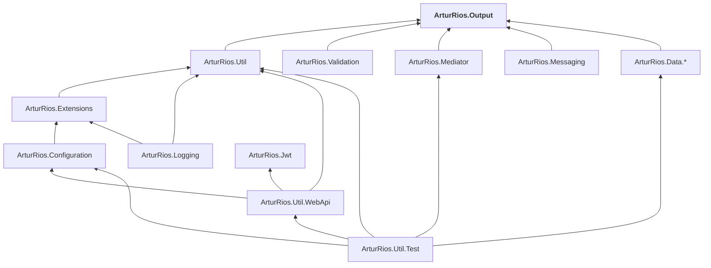

# Dotnet Libraries

[](https://docs.artur-rios.tech/dotnet-libraries)
[](./LICENSE)

The index of the **ArturRios** .NET library family — twelve libraries, twenty NuGet packages, one set of
conventions. This repository holds no code: it is the map, and the source of the site at
<https://docs.artur-rios.tech/dotnet-libraries>.

This repository lives at <https://git.techcraftsmen.net/artur-rios/dotnet-libraries>. The GitHub repository is a read-only mirror of it.

- 📚 **Site:** <https://docs.artur-rios.tech/dotnet-libraries>
- 🧩 **Dependency graph:** <https://docs.artur-rios.tech/dotnet-libraries/docs/dependencies/>
- 📐 **Shared patterns:** <https://docs.artur-rios.tech/dotnet-libraries/docs/patterns/>

## The libraries

All target **.NET 10 (`net10.0`)** and are licensed under the Artur Rios Attribution License. Each lives in its own repository, with its own
tests, its own Docsy documentation site and its own release cadence.

| Library | Repository | Docs | NuGet | GitHub Packages |
|---|---|---|---|---|
| Output | [dotnet-output](https://github.com/artur-rios/dotnet-output) | [Docs](https://docs.artur-rios.tech/dotnet-output) | [](https://www.nuget.org/packages/ArturRios.Output) | [](https://github.com/artur-rios/dotnet-output/pkgs/nuget/ArturRios.Output) |
| Util | [dotnet-util](https://github.com/artur-rios/dotnet-util) | [Docs](https://docs.artur-rios.tech/dotnet-util) | [](https://www.nuget.org/packages/ArturRios.Util) | [](https://github.com/artur-rios/dotnet-util/pkgs/nuget/ArturRios.Util) |
| Extensions | [dotnet-extensions](https://github.com/artur-rios/dotnet-extensions) | [Docs](https://docs.artur-rios.tech/dotnet-extensions) | [](https://www.nuget.org/packages/ArturRios.Extensions) | [](https://github.com/artur-rios/dotnet-extensions/pkgs/nuget/ArturRios.Extensions) |
| Configuration | [dotnet-configuration](https://github.com/artur-rios/dotnet-configuration) | [Docs](https://docs.artur-rios.tech/dotnet-configuration) | [](https://www.nuget.org/packages/ArturRios.Configuration) | [](https://github.com/artur-rios/dotnet-configuration/pkgs/nuget/ArturRios.Configuration) |
| Logging | [dotnet-logging](https://github.com/artur-rios/dotnet-logging) | [Docs](https://docs.artur-rios.tech/dotnet-logging) | [](https://www.nuget.org/packages/ArturRios.Logging) | [](https://github.com/artur-rios/dotnet-logging/pkgs/nuget/ArturRios.Logging) |
| JWT | [dotnet-jwt](https://github.com/artur-rios/dotnet-jwt) | [Docs](https://docs.artur-rios.tech/dotnet-jwt) | [](https://www.nuget.org/packages/ArturRios.Jwt) | [](https://github.com/artur-rios/dotnet-jwt/pkgs/nuget/ArturRios.Jwt) |
| Validation | [dotnet-validation](https://github.com/artur-rios/dotnet-validation) | [Docs](https://docs.artur-rios.tech/dotnet-validation) | [](https://www.nuget.org/packages/ArturRios.Validation) | [](https://github.com/artur-rios/dotnet-validation/pkgs/nuget/ArturRios.Validation) |
| Mediator | [dotnet-mediator](https://github.com/artur-rios/dotnet-mediator) | [Docs](https://docs.artur-rios.tech/dotnet-mediator) | [](https://www.nuget.org/packages/ArturRios.Mediator) | [](https://github.com/artur-rios/dotnet-mediator/pkgs/nuget/ArturRios.Mediator) |
| Messaging | [dotnet-messaging](https://github.com/artur-rios/dotnet-messaging) | [Docs](https://docs.artur-rios.tech/dotnet-messaging) | [](https://www.nuget.org/packages/ArturRios.Messaging) | [](https://github.com/artur-rios/dotnet-messaging/pkgs/nuget/ArturRios.Messaging) |
| Data | [dotnet-data](https://github.com/artur-rios/dotnet-data) | [Docs](https://docs.artur-rios.tech/dotnet-data) | [9 packages](https://docs.artur-rios.tech/dotnet-libraries/docs/packages/#data-access) | [9 packages](https://github.com/artur-rios?tab=packages&repo_name=dotnet-data) |
| Web API Util | [dotnet-webapi-util](https://github.com/artur-rios/dotnet-webapi-util) | [Docs](https://docs.artur-rios.tech/dotnet-webapi-util) | [](https://www.nuget.org/packages/ArturRios.Util.WebApi) | [](https://github.com/artur-rios/dotnet-webapi-util/pkgs/nuget/ArturRios.Util.WebApi) |
| Test Util | [dotnet-test-util](https://github.com/artur-rios/dotnet-test-util) | [Docs](https://docs.artur-rios.tech/dotnet-test-util) | [](https://www.nuget.org/packages/ArturRios.Util.Test) | [](https://github.com/artur-rios/dotnet-test-util/pkgs/nuget/ArturRios.Util.Test) |

## Installing

Every package is published to both [nuget.org](https://www.nuget.org/profiles/artur-rios) and
[GitHub Packages](https://github.com/artur-rios?tab=packages), with the same versions on each. nuget.org
is the default source, so nothing needs configuring:

```bash
dotnet add package ArturRios.Output
```

### Use the GitHub feed

GitHub Packages asks for authentication even for public packages: a personal access token (classic)
with the `read:packages` scope. Register the feed once:

```bash
dotnet nuget add source https://nuget.pkg.github.com/artur-rios/index.json --name artur-rios --username YOUR_GITHUB_USERNAME --password YOUR_TOKEN
```

Add `--store-password-in-clear-text` on Linux and macOS, where NuGet cannot encrypt the password. Then
install from it:

```bash
dotnet add package ArturRios.Output --source artur-rios
```

For a repository or CI, put the feed in a `nuget.config` instead and keep the token in the environment.
In GitHub Actions the workflow's `GITHUB_TOKEN` works, given `packages: read`. The source mapping sends
every `ArturRios.*` package to the GitHub feed and everything else to nuget.org:

```xml
<configuration>
  <packageSources>
    <add key="nuget.org" value="https://api.nuget.org/v3/index.json" />
    <add key="artur-rios" value="https://nuget.pkg.github.com/artur-rios/index.json" />
  </packageSources>
  <packageSourceCredentials>
    <artur-rios>
      <add key="Username" value="%GITHUB_ACTOR%" />
      <add key="ClearTextPassword" value="%GITHUB_TOKEN%" />
    </artur-rios>
  </packageSourceCredentials>
  <packageSourceMapping>
    <packageSource key="artur-rios">
      <package pattern="ArturRios.*" />
    </packageSource>
    <packageSource key="nuget.org">
      <package pattern="*" />
    </packageSource>
  </packageSourceMapping>
</configuration>
```

## How they depend on each other

Family dependencies only; third-party packages are listed on each library's own site.



`ArturRios.Output` is the root — almost everything needs it in its signatures. `ArturRios.Jwt` is
deliberately standalone. The full graph, including the nine `Data` packages, is on the
[dependencies page](https://docs.artur-rios.tech/dotnet-libraries/docs/dependencies/).

## The patterns

These are the ideas that repeat across the family; the
[patterns page](https://docs.artur-rios.tech/dotnet-libraries/docs/patterns/) covers them in full.

1. **Outputs, not exceptions.** Anything that can fail for an expected reason returns a `ProcessOutput`,
   `DataOutput<T>` or `PaginatedOutput<T>` envelope. Validation failures, missing records and
   optimistic-concurrency conflicts arrive as errors *on the result*; exceptions are for genuine defects.
2. **One capability, one package.** Nothing is bundled for convenience. Even within `ArturRios.Data`,
   each backend is a separate package, so SQLite support does not drag in the MongoDB or AWS SDKs.
3. **A core plus interchangeable providers.** `*.Core` packages define the abstraction and provider
   packages supply the implementations — `Relational.Core` with PostgreSQL / MySQL / SQLite / Dapper,
   `Export` with `Export.Excel`, `Configuration` with its source providers.
4. **Composition over the built-in container.** Registration always uses the standard
   `IServiceCollection`. `ArturRios.Mediator` resolves each handler from a *fresh DI scope*, so scoped
   dependencies like a `DbContext` are isolated per execution.
5. **Validation as a first-class result.** `FluentValidator<T>` turns FluentValidation results into a
   `string[]` or an `Output` envelope, behind an injectable `IFluentValidator<T>`.
6. **Configuration from layered sources.** `ConfigurationLoader` composes JSON, environment variables and
   `.env` files under one rule: later sources override earlier ones — and the same loader backs both the
   web API startup and the functional test base.
7. **Diagnostics that cross process boundaries.** Caller info and trace IDs in `ArturRios.Logging`; W3C
   `traceparent` propagation through `ArturRios.Util.WebApi` middleware and outgoing calls.
8. **Given / When / Then tests.** xUnit throughout, with `ArturRios.Util.Test` supplying assertions,
   in-memory fakes and environment-aware attributes. Every test class carries a `Category` trait —
   `Unit` or `Functional` — so the two kinds run and report separately. `ArturRios.Data` adds a third,
   `Integration`, for tests that need a server the suite cannot provision (MySQL).
9. **Identical repository layout.** `src/`, `tests/`, `docs/`, `README.md`, `LICENSE`.
10. **Identical CI.** `run-tests.yml` on pushes and PRs, running unit and functional tests as two
    separate jobs (three in `ArturRios.Data`, which adds integration tests against a MySQL container); `build-docs-and-coverage-report.yml` deploying docs and coverage to GitHub Pages;
    `publish-package.yml` packing and pushing on a tag.
11. **Consistent packaging metadata.** `net10.0`, the Artur Rios Attribution License (packed `LICENSE` file), XML docs, an `ArturRios.*` package id, and
    independent per-package versions — there is no lockstep family version.

## Building this site

The site is Hugo with the [Docsy](https://www.docsy.dev/) theme, installed as an npm package.

```bash
git clone https://git.techcraftsmen.net/artur-rios/dotnet-libraries.git
cd dotnet-libraries/docs
npm ci
npm run serve
```

`npm run build` produces the static site in `docs/public`. The site is served at
<https://docs.artur-rios.tech/dotnet-libraries/>: the [`Dockerfile`](Dockerfile) builds it with the address it is
served at (`PUBLIC_HOST` and `PUBLIC_PATH`) and serves it with static-web-server, and Jenkins builds and deploys that image
when `main` changes. The bare address, <https://docs.artur-rios.tech/>, redirects here.

The `verify` check (`ci/verify.sh`) runs `scripts/verify_versions.py` when `docs/data/family.yaml` or the script changes: it
compares the versions in the data file with nuget.org.

## Protected `main`

Every repository's `main` requires a pull request, one approving review, and the CI jobs — **Unit tests**
and **Functional tests**, plus **Integration tests** where a repository has them — to pass. Force pushes and branch deletion are refused. Administrators are exempt
from the rules, so the repository owner keeps a bypass and nobody else has one.

## Contributing

Open the issue or pull request on the repository of the library it concerns. Anything about the family as
a whole — a wrong dependency edge, a pattern worth documenting — belongs here.

## Legal

This project is licensed under the [Artur Rios Attribution License](./LICENSE). It is free and open source: you may view, use, fork, modify, and extend it, provided you credit the author, Artur Rios, with a link to [artur-rios.tech](https://artur-rios.tech) or [github.com/artur-rios](https://github.com/artur-rios). Copyright © Artur Rios.
